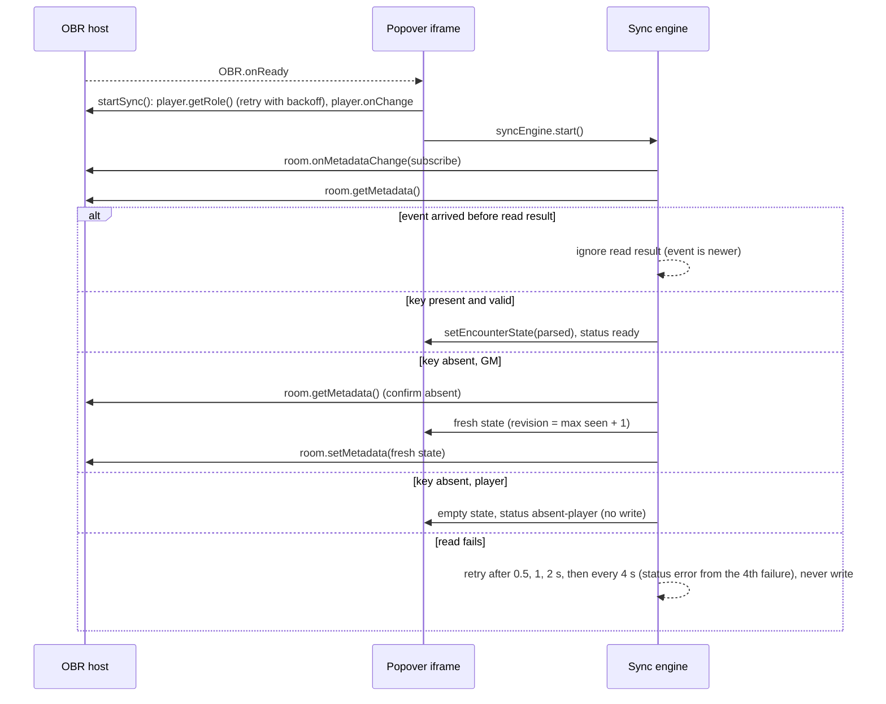
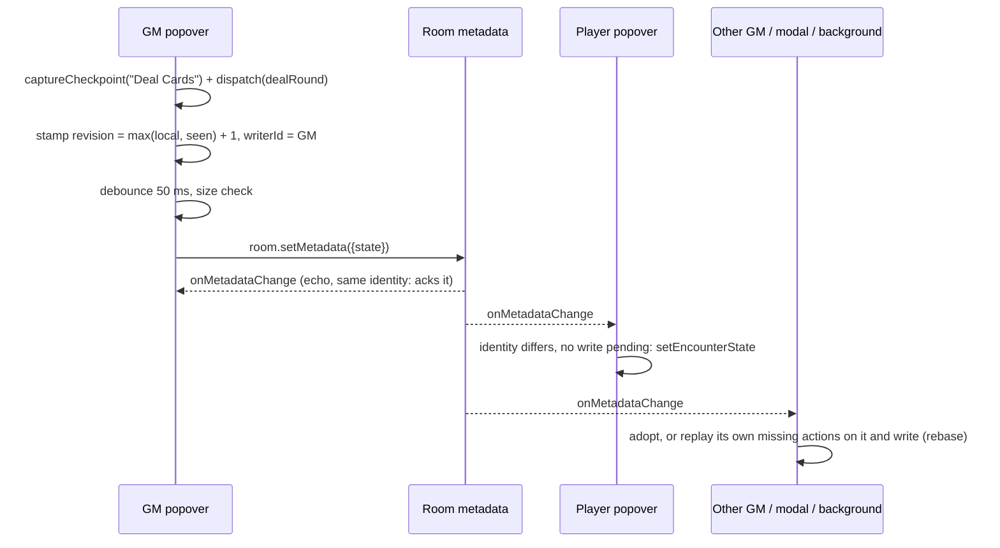
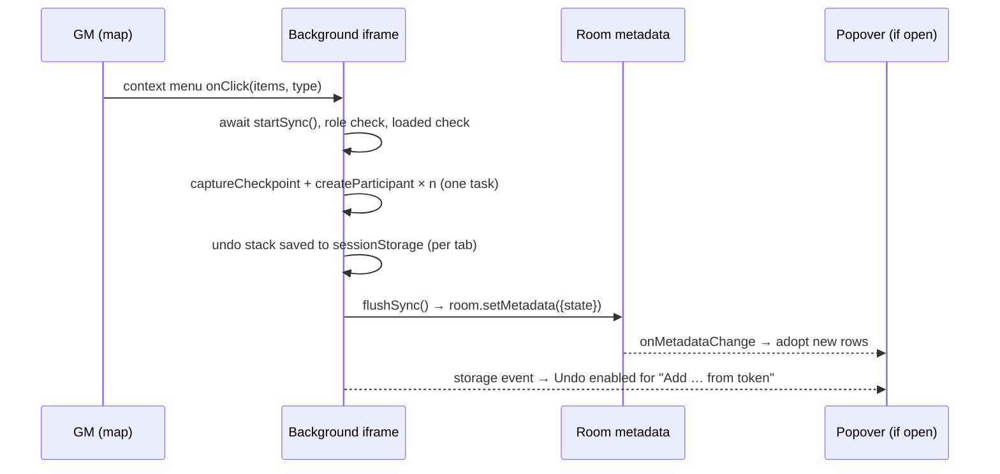

# How the app integrates with Owlbear Rodeo

This document tells how the SWADE Initiative Tracker works with Owlbear Rodeo (OBR) **as the code is now**. For general platform behaviour, see [owlbear-platform.md](owlbear-platform.md).

SDK: `@owlbear-rodeo/sdk` 3.1.0.

---

## 1. Summary

| Topic | Current behaviour |
|---|---|
| Surfaces | Action popover (`/`), two modals (`/?view=add-participant`, `/?view=card-chooser&participantId=…`), and a hidden background page (`/background.html`). |
| Shared state | One object, `EncounterState` v2, in **room metadata** under the key `rodeo.owlbear.swade-initiative/state`. |
| Scene API | Not used. No scene gate. All scenes in the room share one encounter. |
| Item metadata, player metadata, broadcast | Not used. Modals talk to the background page over a same-origin `BroadcastChannel` (section 2.3). |
| sessionStorage | Undo history only, key `swade-undo-v2-<roomId>`, per browser tab. Older versions used localStorage; those keys are removed on start. |
| Sync | One Redux store and one sync engine per iframe. Only GMs write. Each state has an identity `(revision, writerId)` and stores its `parent` (the room state it was made from). All clients follow the room's last write. When two GMs act at the same time, a GM whose actions the room state misses replays them on top of it and writes the result, so both actions survive. When that is not possible, the GM gets one warning that the change was discarded (section 5.7). |
| Roles | From `OBR.player.getRole()` and `OBR.player.onChange`. GM controls and privacy are UI-only. |
| Undo | Per-tab stack (one per OBR connection), shared by all iframes of the extension in that tab. Undo is possible only while the room still holds the state that the last action made. After a replay, the top checkpoint moves onto the other GM's state, so Undo removes only this GM's action. An Undo is never replayed. |
| Context menus | Registered once by the background page, GM only. |

---

## 2. Entry points and iframes

### 2.1 Manifest

[public/manifest.json](../public/manifest.json):

- `action`: `popover: "/"`, `width: 360`, `height: 600` (maximum sizes).
- `background_url: "/background.html"`.
- No `permissions`.

[vite.config.ts](../vite.config.ts) builds two pages: `index.html` (popover and modals) and `background.html`. There are no source maps in `dist` (everything in `dist` is deployed, and no error tracker uses them). Vendor code is split into chunks (`vendor`: React, Redux, the OBR SDK; `react-dom`; `mui`: MUI and the rest), so no chunk is over 500 kB and the background page loads only `vendor` and the shared app chunk.

### 2.2 Action popover (`/`)

[index.html](../index.html) loads [main.tsx](../src/main.tsx). Render tree:

```
React.StrictMode
└─ PluginGate              (renders nothing until OBR.onReady)
   └─ PluginThemeProvider  (MUI theme from OBR.theme)
      └─ App
         └─ Provider (Redux)
            └─ AppErrorBoundary
               └─ SyncStatusGate
                  └─ UndoProvider
                     └─ view: InitiativeTracker | AddParticipantModal | CardChooserModal
```

`App` calls `startSync()` once ([store.ts](../src/store/store.ts)). `startSync` is idempotent. It reads the role, listens for role changes, and starts the sync engine.

### 2.3 Modals

[App.tsx](../src/App.tsx) picks the view from the `view` query parameter:

| URL | Opened by | Modal id |
|---|---|---|
| `/?view=add-participant` | "Add Combatant" in [HeaderBar.tsx](../src/components/HeaderBar.tsx) | `rodeo.owlbear.swade-initiative/add-participant` |
| `/?view=card-chooser&participantId=<rowId>` | Card chip in [ParticipantRow.tsx](../src/components/ParticipantRow.tsx) (GM only) | `rodeo.owlbear.swade-initiative/card-chooser` |
| `/` (no `view`) | Action popover | – |

Each modal is a separate iframe. It has its own store, sync engine, writer id and undo store. It shows content only after its own sync engine has loaded the room state.

**Modal changes are dispatched by the background page** ([actionChannel.ts](../src/actionChannel.ts)). Closing a modal destroys its iframe, its engine and its action log. If a modal wrote a change itself and another GM's write that misses it landed after the modal closed, no engine could replay it, and the change was lost (seen in a real room). So a modal sends its Redux actions to the background page of the same OBR connection, which lives while the room is open:

1. The modal posts `{ kind: "request", id, connectionId, sentAt, op }` on the `BroadcastChannel` `rodeo.owlbear.swade-initiative/modal-actions`. `op` is `dispatch` (undo description + actions; no actions = save only, for Try again) or `cancel-add` (row id).
2. The background handles only requests with its own connection id (`OBR.player.getConnectionId()`, the same for all iframes of one tab), so a second tab of the same GM ignores them. It awaits `startSync()`; if it is not a GM, not loaded, or the room is `invalid` / `too-new`, it replies `rejected`. It also rejects a request older than 1 s (`ACCEPT_WINDOW_MS`), so it never dispatches a request whose modal may have fallen back already.
3. Otherwise it captures one undo checkpoint and dispatches the actions in the same task (as for a context menu click), replies `accepted`, saves (`saveChanges`: `retrySync` + `flushSync`), and replies `result` with `ok`. Its engine logs the actions and replays them on any later room state that misses them.
4. The modal closes after `result` with `ok`. On `ok: false`, or no result within 30 s after acceptance, it shows "Could not save — try again". The modal's own store gets the change from the room event.

Transport: same-origin `BroadcastChannel`, not `OBR.broadcast` with destination LOCAL: whether LOCAL reaches the background page is decided by the host (the SDK only forwards it), LOCAL messages count against the network rate limit, and the SDK's broadcast unsubscribe carries no listener id. Messages are untrusted (any same-origin page can post): only `createParticipant`, `selectKeeperCard`, `discardExtraCandidates`, `addCandidateCard` and `undoLastDraw` are accepted, rebuilt from checked fields (at most 10 per request); anything else is ignored without a reply.

**Fallback.** If no background accepts within 2 s (`ACCEPT_TIMEOUT_MS`; for example the background page is not loaded), or it rejects, or `BroadcastChannel` is missing, the modal dispatches the change itself (checkpoint + dispatch in one task) and saves with `saveAndSettle`: save, wait 1.5 s (`SETTLE_MS`) so its engine can replay the change onto a write that landed right after it, save again, then close. A conflicting write that lands after the modal closed can still drop the change in this path; a console warning marks it.

Failed save: Add Combatant shows Try again (background: a save-only request; fallback: `saveAndSettle` again; it never adds a second row) and Cancel (background: `cancel-add`, which removes the row and drops the top checkpoint only if it is this add's (its snapshot does not hold the row; a newer token add keeps its checkpoint); fallback: `discardOwnTopCheckpoint`, then remove the row). Cancel saves the removal (an earlier write may have put the row in the room) and closes only when that is saved; otherwise the modal stays open with the error. The card chooser retries with Confirm or Cancel: the action is sent again and changes nothing the second time. In the fallback, a draw is saved at once (`saveChanges`), so a backdrop close within the debounce cannot drop it.

`createParticipant` is idempotent by row id: if the modal falls back after the background already took the add (its main thread was blocked past the accept window), the second dispatch adds nothing.

Card chooser:

- **Confirm** selects the keeper card, then closes.
- **Cancel** dispatches `discardExtraCandidates`: the extra drawn cards go to the discard pile.
- Closing with the backdrop keeps the candidates. They show again the next time the chooser opens, and End Round discards them. No card is lost.
- If the row is removed while the chooser is open (another GM, or an undo), the chooser shows "This combatant no longer exists." and a Close button.
- "+" (draw) is enabled only when `addCandidateCard` would draw (`canAddCandidateCard`, the same rule as the reducer): cards are dealt or a round runs, and the deck or the discard pile has a card. If the round ends while the chooser is open (End Round by this or another GM), the candidates are gone, "+" and Choose turn off, the chooser says "The round has ended. Cards can be drawn after the next deal.", and Cancel closes it without a change.

Add Combatant: Enter in the name field adds the combatant as an NPC.

### 2.4 Background page (`/background.html`)

OBR loads the background page as a hidden iframe for the whole time the room is open. [background.ts](../src/background.ts), after `OBR.onReady`:

1. Creates a `LocalUndoStore` for this iframe.
2. Calls `startSync()` (own store, own sync engine, own writer id).
3. Starts the modal request handler (section 2.3).
4. Registers the three token context menus ([contextMenu.ts](../src/contextMenu.ts)).

So the menus work even when no one opened the popover, and modal changes outlive the modal.

---

## 3. Startup and sync status

### 3.1 Sync status

The sync engine ([syncEngine.ts](../src/store/syncEngine.ts)) has a status. `useSyncStatus()` gives it to React.

| Status | Meaning |
|---|---|
| `loading` | First read not done yet, or it is retrying. |
| `ready` | Room state loaded. |
| `absent-player` | No state in the room. Players see an empty tracker. |
| `invalid` | Room data cannot be parsed. |
| `too-new` | Room data has a newer state version or a higher sync protocol than this code (section 4.5). |
| `error` | First read keeps failing, or a write failed after retries. |
| `too-large` | State is over the room size budget and was not written. |

The snapshot also has `loaded` (true after the first successful read or event), `bytes` (encoded size) and `nearLimit` (size above the warning threshold).

### 3.2 Gating

[SyncStatusGate.tsx](../src/components/SyncStatusGate.tsx) wraps every view, modals included:

- Not loaded: a spinner. After the read retries run out: "Cannot reach the room" (it keeps trying).
- `too-new`: "A newer version of the initiative tracker is in use. Reload this page to update." It stays until the page is reloaded.
- `invalid`: GMs get a "Reset tracker" button. Players are told to ask the GM.
- All other cases: the view.

Write problems after load (`error`, `too-large`) do not hide the view. [SyncIndicator.tsx](../src/components/SyncIndicator.tsx) shows them as a chip in the header: "Not saved – retry" (GM; click to retry now) or "Not saved" (player), "Not saved – too large", and "Storage almost full".

[AppErrorBoundary.tsx](../src/components/AppErrorBoundary.tsx) catches render errors. It shows **Retry** and, for GMs, **Reset tracker**.

### 3.3 Startup sequence



---

## 4. Stored state

### 4.1 Room metadata

- Key: `rodeo.owlbear.swade-initiative/state` (`STATE_KEY` in [syncEngine.ts](../src/store/syncEngine.ts), built with [getPluginId.ts](../src/getPluginId.ts)).
- Room metadata is shared by all scenes in the room. The tracker does not depend on a scene.
- The room has **16 kB for all extensions together**. See the size guard in section 5.5.

### 4.2 v2 shape

[types.ts](../src/store/types.ts):

```ts
interface EncounterState {
  version: 2;
  round: number;              // 0 before the first deal
  phase: 'setup' | 'between_rounds' | 'cards_dealt' | 'in_round';
  deck: {
    remaining: CardId[];
    inPlay: CardId[];         // exactly the cards on the rows
    discard: CardId[];
    reshuffleAfterRound: boolean;
    jokersDealtThisRound?: number; // Joker deals this round, net of Undo Last Draw (optional; absent = 0)
  };
  rows: ParticipantRow[];     // display order
  turn: { activeRowId: string | null };
  settings: { hideNpcFromPlayers: boolean };
  revision: number;           // stamped on every local change
  writerId: string;           // iframe that made the last change ("" if fresh or migrated)
}
// Stored form only (not in EncounterState), written by the sync engine:
//   parent: { revision: number; writerId: string; of: string }
// the identity of the room state this state was made from; `of` is "revision/writerId"
// of the state itself.
//   client: { syncProtocol: number; appVersion?: string; of: string }
// the app that wrote the state (section 4.5); `of` as for parent.

interface ParticipantRow {
  id: string;                 // short random id (8 chars)
  name: string;
  imageUrl?: string;          // https only
  type: 'PC' | 'NPC' | 'GROUP';
  inactive: boolean;
  onHold: boolean;
  revealed: boolean;
  currentCardId?: CardId;
  candidateIds: CardId[];
  actNowTurn?: boolean;       // Act Now turn without a card this round (optional)
}
```

Card ids: `AS`, `10H`, `JK-R`, `JK-B`, and so on. The top of the deck is the end of `remaining`.

`parent` is the sync engine's lineage (section 5.7). A state made in a room without state stores `{ revision: 0, writerId: "" }`. Older app versions do not write it. The released v1 app keeps unknown keys when it writes (it spreads the stored object and raises the revision), so its states carry the `parent` of the state it copied; `of` then names another state, and the codec ignores that parent. It adds about 70 bytes to each write.

### 4.3 Codec

[stateCodec.ts](../src/store/stateCodec.ts) is the only path from stored data to `EncounterState`.

`encodeEncounterState` writes the same keys as `EncounterState`, so v1 clients can still read it. It omits:

- `inactive`, `onHold`, `revealed`, `actNowTurn` when false.
- `deck.reshuffleAfterRound` when false.
- `deck.jokersDealtThisRound` when 0 or absent.
- `imageUrl` when it is not an https URL.

It never omits arrays (v1 code calls `.map` on them). It adds `parent` and `client` only when the sync engine gives them.

`parseEncounterState(raw)` returns `absent`, `ok` (with the state, its `parent` and its `client`, each `null` when missing, malformed, or its `of` is not the state's own identity; a malformed `appVersion` alone is dropped), `invalid` or `too-new`. It never throws. It:

- Runs the migrations.
- Drops rows with a bad shape and duplicate row ids.
- Keeps only known card ids, each card once. Cards missing from all piles go to the discard pile.
- Makes row cards agree with the piles: a row keeps only cards in `inPlay`, each card on one row only (the first row wins), each candidate once. In-play cards that no row holds go to the discard pile.
- Drops `deck.jokersDealtThisRound` outside `cards_dealt` / `in_round`, and when it is not a positive integer.
- Keeps `imageUrl` only for https.
- Clears `activeRowId` if that row does not exist.
- Uses defaults for a missing revision (0), writer id (`""`) and privacy setting (on).

### 4.4 Migrations

[migrations.ts](../src/store/migrations.ts), `CURRENT_STATE_VERSION = 2`.

- A missing `version` means v1.
- Migrations are pure and run on a `structuredClone`. The migration that makes version N is stored under key N.
- v1 → v2 drops the unused row fields `tokenIds` and `drewThisRound`, and sets `writerId: ""`.
- A version above the current one is `too-new`: the client does not adopt it and does not write.
- A client does not write the migrated state on load. A GM writes it with the next change.

Policy for a new version: add a migration, keep the stored keys readable by older clients when possible, and add a codec test with a fixture of the old version.

### 4.5 App version and sync protocol

Every write stores `client: { syncProtocol, appVersion, of }`:

- `appVersion`: the `version` of package.json (`APP_VERSION` in [syncEngine.ts](../src/store/syncEngine.ts)). Omitted only when unknown. Information only: a different app version with the same protocol changes nothing.
- `syncProtocol`: `SYNC_PROTOCOL` in syncEngine.ts, an integer that only rises. Raise it by one when an older engine would merge or replay the new engine's states wrongly (lineage, replay rules), even when the state version stays the same.
- `of` binds it to the state, as for `parent`: an older app that copies unknown keys leaves a `client` that counts as missing. v1 and earlier v2 readers ignore the key. It adds about 60 bytes.

The engine reads room values with `parseRoomValue`: a state with a higher `syncProtocol` than its own is `too-new`, exactly like a newer state version. The client does not adopt it, does not replay or merge onto it, does not write, discards a pending change with the discard WARNING, and the gate shows "A newer version of the initiative tracker is in use. Reload this page to update." until the page is reloaded.

Older direction: events arrive in room order, so a state without `client` that arrives after a room event with a `client` state was written later, by an older app. Then a GM gets one WARNING per iframe (reads do not make an iframe aware: a read can be ahead of events that still carry older states): "another player or GM uses an older version. Ask them to reload the page." Players get no notice. A state of an older app is otherwise followed as before (section 5.7, unknown lineage).

---

## 5. Sync engine

[syncEngine.ts](../src/store/syncEngine.ts) and [store.ts](../src/store/store.ts). Each iframe (popover, each modal, background page) has its own store and engine.

### 5.1 Identity and revision stamping

- Each iframe has a random `writerId`.
- A state is identified by `(revision, writerId)`.
- `createStampingReducer` wraps the slice reducer. When an action changes the state, the result gets `revision = max(previous revision, highest revision seen in the room or written by this iframe) + 1` and this iframe's `writerId`. Counting own writes whose echo has not arrived yet means that an iframe never makes two different states with the same identity.
- `setEncounterState` (sync only) is not stamped. A no-op action returns the same state and is not stamped.
- Reducers do not touch `revision`.
- States the engine makes itself (rebase, re-stamp, fresh state) are stamped above every revision seen, written, or held locally, so they never reuse the identity of an unwritten local state.
- `createAppStore` also reports every local action that changed the state (`subscribeActions`, with the state before it). The engine keeps them for replay (section 5.7).

### 5.2 Inbound (room → store)

- The engine subscribes to `room.onMetadataChange` before it reads.
- If an event arrives before the first read result, the read result is ignored.
- Model: `acked` is the newest identity that the engine knows the room holds from its side (its last successful write, or the last state it adopted). The local state is **dirty** when it is an own change (this `writerId`) whose identity is not `acked`, and it was not given up with the discard WARNING (`discarded`). The engine keeps a given-up change as the state object, not as its identity: it was never written, so a later state (for example a fresh state after the key was deleted, or a re-stamped copy) can get the same identity and must still be written. There are no echo timers.
- Events arrive in server order, so the last event is the room value. The local state follows it, whoever wrote it: a state that misses some of our actions is followed by replaying them on top of it (rebase, section 5.7). Exceptions:
  - An event that carries the local state (an own echo) acks it. This is also how an attempt that was reported as failed but landed after all becomes saved (status `ready`, no warning).
  - An older own state (lower revision than the own local state) is a late echo: it is ignored, because the newer state is written or coming. This does not apply when the newer state was given up (for example invalid data arrived while this GM was demoted): then the room holds the older write, and the engine follows it. If that older state is an attempt that was reported as failed (for example a timeout) and the newer state is already written (its write finished or its echo arrived), the older attempt may have landed after it, so the engine writes the newer state again.
  - While the local state is dirty and a write is still coming (debounce, queued or running write loop), a new foreign state is only recorded: the write loop rebases onto it before it writes, so nothing of it is overwritten.
  - An echo of the local state that comes right after a foreign state that the engine did not follow yet means that our write landed after it (and overwrote it). The engine rebases onto that state as well and writes again. The other writer would also replay its own actions on ours, but it may be gone (a modal that closed after its write).
  - An own state that is not the local one (for example an echo that came late, after newer values) is followed, and the engine reads the room once to confirm the real value.
- It does not compare revisions, so all clients end on the room's last write (which, after a rebase, holds every GM's actions).
- The echo can arrive before or after `setMetadata` resolves. If a new value arrived during a write and our echo did not arrive before the write resolved, the engine cannot tell which landed last. For a foreign state it rebases onto it (our actions on top are written next); if that state already held all our actions and was adopted, it reads the room once (our write may have landed after it). For another value (key deleted, invalid data, or an own attempt that was reported as failed and may land late) it writes the same content again. This also covers a host that coalesces events (delivers only the latest value), where our echo may never arrive. A late echo of an earlier successful own write causes no rewrite: writes are serial, so it landed first.
- **Revision:** a rebased state is stamped above the state it was rebased onto. When our write lands after a higher foreign revision, one of the two writers rebases and writes above it, so the room's revision rises again. (The former "re-raise the same content" rewrite is gone: it kept landing after the other GM's rebase onto our state and caused a write loop.)
- When the key disappears (for example a v1 client's Full Reset), a GM writes a fresh state once. A player shows an empty tracker. Unrelated metadata changes do not cause a new shuffle.
- **Invalid data or a newer version** (`invalid`, `too-new`) that arrives while an own change is waiting to be written (debounce or queued write loop) is never overwritten: the debounce is cancelled, the change is given up (`discarded`) with one WARNING "Your unsaved change was discarded.", and the status is set. If the write in flight carries exactly that change, its echo decides: an echo after the value means our write landed last (status `ready`, change kept, no warning); a write that ends without its echo gets the WARNING, is not written again, and the engine reads the room once.
- **Discarded actions leave the action log.** Whenever the discard WARNING is shown (also for a key deletion, invalid data or a demotion), the logged actions are dropped, so a later room state derived from an older one never brings the discarded change back by replay (section 5.7).
- **Missed events.** The host may drop events (for example across a reconnect). The engine does not poll. It reads the room once (and handles the result like an event, unless an event arrived meanwhile) when the iframe wakes: it becomes visible again (`visibilitychange`), gets focus, or the browser comes back `online` (`subscribeWake`, from store.ts; one read at a time). Such a read is handled also when it holds a state of unknown lineage (section 5.7, "Unknown lineage": the engine checks which of its actions that state already includes). It also reads the room once `ECHO_WAIT_MS` (5 s) after a write attempt whose echo has not arrived (a successful write, or a failed attempt that may land later); the arrival of the echo cancels it. A client that misses an event and never wakes (and writes nothing) stays stale until the next room change.
- Inbound events do not cause a read, except an own state that is not the local one (see above). The engine also reads the room once more (and handles the result like an event, unless an event arrived meanwhile) in three cases where a write may have landed without an echo: a write loop ends after this client lost the right to write (a demoted GM), a demoted GM follows the room after a failed or unsaved write, or a write finishes after the engine adopted a foreign state during it. A read can be ahead of the events still on their way: a read result whose lineage the engine does not know yet is ignored (those events bring it, its ancestors first).
- **Role changes:** the engine subscribes to the role (`subscribeRole`, from store.ts). When this client may no longer write and no write is pending, it follows the room again: an unsaved change that the room does not include (it cannot be replayed without writing) is discarded with one WARNING, so the status does not stay `error`. A player promoted to GM in a room without state creates a fresh state.

### 5.3 Outbound (store → room)

- Only GMs write, checked before every attempt (a GM demoted to player stops writing, also in the middle of retries). A player store can change locally, but it is never written.
- No write before the first successful read, and no write while the read keeps failing. No write in `too-new`. In `invalid` the gate hides the view and the context menus refuse, so the only write is the GM's "Reset tracker". A pending own change never overwrites invalid data or a newer version that arrived meanwhile (section 5.2).
- Writes go through one serial write loop, debounced 50 ms. While the local state is dirty, the loop sends the newest local state; a change made while a write is in flight is written next. There is no read before a write.
- If the local revision is not above the highest revision seen, the engine stamps it again above that revision before it writes.
- A successful write clears only `error` / `too-large`. A `too-new` or `invalid` status set by an event during the write stays, so the gate stays closed and nothing more is written. When no value of our key arrived during the write and its echo is missing, the room holds our state, so the status becomes `ready` (for example after the GM's "Reset tracker" of invalid data).
- `RateLimitHit` and SDK timeouts are retried after 0.5, 1 and 2 s (4 attempts in total). After the last failure, the GM gets an ERROR notification and the status becomes `error`. Without a user action the status, the unsaved change and the one ERROR stay (unrelated events and wake reads of an unchanged room change nothing). The next local change tries again. A GM can also click the "Not saved – retry" chip: `retrySync()` (`syncEngine.retry()`) queues the newest local state again. `retry()` does nothing unless the status is `error` or `too-large` and this client can write.
- Concurrent GM edits: no action is lost. Each GM replays its own actions that a room state misses on top of it (section 5.7), and all clients converge on the last write, which holds both changes. No warning, except in the fallback cases of section 5.7.
- Unsaved change (status `too-large` or `error`): events that do not change our key (for example another extension's key) are ignored, so the local change and the status stay. In `too-large`, such an event re-checks the size, so the state is written as soon as another extension frees space; the GM can also click the "Not saved – too large" chip. If our own attempt that was reported as failed (for example a timeout) lands later, the change counts as saved, with no warning. A newer state from another GM is rebased onto: the unsaved actions are replayed on it and written again (the status stays until a write succeeds). A GM demoted to player with an unsaved change gets one WARNING that it was discarded when it follows the room again.

### 5.4 Flush before modal close

`flushSync()` cancels the debounce, writes now, and waits until the write loop is idle. It resolves to `true` when the local state is not dirty (it is in the room or there was no local change), and `false` when it is not: the write failed, the state is too large, or this player is not a GM. It does not write again after a failed write. Modal changes are saved by the background page with `saveChanges()`, which calls `retrySync()` first, so "Try again" writes the change again (in the fallback, the modal calls `saveAndSettle()`; section 2.3). The background page awaits `flushSync()` before a context menu click finishes. Full Reset from the error boundary also awaits it.

### 5.5 Size guard

Before each write the engine measures the encoded state (key included, UTF-8 bytes). The measure does not include `parent` and `client` (about 130 bytes together); the 512-byte headroom covers them.

| Constant | Value | Effect |
|---|---|---|
| `ROOM_LIMIT_BYTES` | 16384 | Room limit for all extensions. |
| `SAFETY_BYTES` | 512 | Headroom. |
| Budget | 16384 − bytes of other keys in the last seen room metadata − 512 | Above it: no write, one ERROR notification, status `too-large`. |
| `WARN_BYTES` | 10240 | Above it: one WARNING notification each time the size crosses it, and the "Storage almost full" chip. |

A 40-row encounter encodes to less than 9 kB (codec test).

### 5.6 GM action → write → other clients adopt



### 5.7 Rebase: no GM action is lost to a concurrent write

Room metadata has no compare-and-set, so two GMs (or two iframes) that act at about the same time each write a whole state, and the last write would drop the other change. The engine merges them by replaying actions.

**Stored lineage.** Each written state stores `parent: { revision, writerId, of }`, the identity of the room state it was derived from (the engine's `acked`: the last state it adopted, rebased onto, or knows it wrote), bound to the state's own identity (`of`). A state made in a room without state stores `{ revision: 0, writerId: "" }` (a fresh root). The field exists only in the stored form (codec), not in `EncounterState`, so states compare equal in every iframe. A writer that copies the field to another state (the released v1 app) leaves a parent whose `of` does not match: that state has no parent, like any older client's state. It adds about 70 bytes.

**Action log.** Each engine keeps its own local actions (the Redux actions, from `subscribeActions`), oldest first, at most 50. For each action it keeps the identity of the state it was applied to and the revision of the first written state that included it. It also keeps the newest action that reached the room (a write that succeeded or echoed). An action dropped from the full log before it reached the room makes every room state that misses it unknown (warning), never a silent loss.

**What a room state includes.** For every room state (in room order) and every own write, the engine remembers the newest own action it includes (at most 200 identities). An own write includes every logged action. Another state includes what its parent includes. A fresh root (parent `{ revision: 0, writerId: "" }`, written after the key was deleted) includes the actions that the room held when the engine saw the key deleted: replaying them would bring back a reset encounter. Actions after that (also those this engine made before it saw the deletion) are replayed. When the parent is not known: a descendant always has a higher revision than its ancestor, so the state includes no action first written above its parent's revision (without a parent: above its own revision − 1). If an action written at or below that bound is still logged, the answer is unknown. A state with revision 0 and no parent (a fresh v1 state) is assumed to include every action of this engine that reached the room.

**Key deleted (a released v1 GM's Full Reset).** The actions the room held when the engine saw the deletion (`rootSeq`) count as included in every later state of unknown lineage too (also a v1 state with no parent at revision 1), so they are never replayed onto the reset. If the deletion arrives while an own change is waiting to be written, the engine does not write the old encounter back: it replays only its actions after `rootSeq` on a fresh state and writes that (an Undo among them: the discard warning).

**Following a room state F.**

| F includes | Result |
|---|---|
| All logged actions | Adopt F. |
| Some or none (known) | Replay the missing actions, in order, through the slice reducer on top of F. The result is a new own state (`parent` = F, revision above F), written as usual. Actions whose replay changes nothing are dropped from the log (an add of a participant whose id F already holds changes nothing). If such an action's intent is not met on F, the GM gets the WARNING "may have replaced your last change" instead of a silent drop: a keeper choice (`selectKeeperCard`) whose card is no longer among the row's candidates (for example its draw was replayed and dealt another card, because another GM's late joiner took the first one). The row then keeps its original card and the extra candidate, and the GM chooses again. Every other action sets a target value or acts on a row, phase or turn that the other change already handled (removed, dealt, advanced), so dropping it is right. Turn navigation follows its own simple rule (see "Turn navigation" below). Reducers are pure (see "Seeded shuffles" below), so a replayed Deal or draw shuffles the same way on the new base. |
| Unknown (see "Unknown lineage" below) | Check which logged actions F already includes, then as in the rows above. |
| Unknown and the check fails, or a missing action is an Undo restore (`restoreSnapshot`), or replay throws, or this client may not write | Adopt F and clear the log (discarded actions are never replayed later). WARNING: "Your unsaved change was discarded." when the local state held an unsaved change, else "A change in the room may have replaced your last change." (the actions reached the room, but F may not include them). |

**Turn navigation.** Next / Previous (`setActiveParticipant`) and Start Round (`startRound`) record, when they are made, the turn position of the local state: `from = round, phase, active row`. On any replay (known or unknown lineage) such an action is applied only when F's turn position equals `from` (nobody changed the turn since) and its target row (Next / Previous) exists and can take a turn (`canTakeTurn`: a target held, or that lost its turn, is refused). Otherwise it is dropped silently and leaves the log. It never warns, and it cannot apply twice: after it applies, the position is no longer `from`. Concurrent conflicts on the turn are rare, and the people at the table sort them out. Examples: two GMs press Next on the same turn: the first write wins, the other GM's Next is dropped (the turn moved), the turn advances once. Our Next and another GM's rename: the turn did not move there, so our Next applies and both changes are kept. Another GM's Previous, Act Now or End Round at the same time: the turn moved, our Next is dropped. A late joiner placed between the active row and our target does not stop our Next (the turn did not move).

**Unknown lineage.** F names a parent this engine never saw (for example it missed two or more room events while asleep or offline, events were coalesced, or an older app version wrote F). The engine replays its logged actions in order on F without changing anything. If every replay is a no-op with its intent met, F holds all of them: F is adopted with no warning, the log is kept, and F is remembered as including them (so its children have a known lineage). If the replay of a saved action (one that a write attempt carried) changes F, nothing is re-applied: F is adopted with the warning (the last row of the table). A saved content action whose replay is a no-op only because its row is gone (for example our rename of a row another GM removed) is no evidence that F holds it: the warning too (review 10). Turn navigation does not count in this check (it neither confirms nor warns). A saved one comes before every unsaved action, so it always counts as included and is never applied again; an unsaved one is replayed by the rule above. The engine cannot tell whether F never got that action or another GM reversed it on purpose (removed our added row, cleared our Hold, moved the turn on after our Next, ended the round we dealt), and re-applying it would bring back what that GM removed or apply a step twice. Only unsaved actions (never carried by a write attempt, so no room state can hold or have reversed them) that come after the actions F holds are replayed on F and written, as in the "Some or none" row; their no-op replays stay in the log. Remaining false warning: a saved content change that F holds in a form that a later step changed (for example our rename, after another GM renamed the same row again).

An Undo restores a whole snapshot, so replaying it over another GM's change would erase that change; it is never replayed. While a write is coming, the write loop rebases before it writes (so the local state can briefly show the older content until the debounce ends).

**Concurrent conflicting actions.** Both are applied in room order. Actions carry their target: Next is `setActiveParticipant(nextRowId)`; two GMs who press Next on the same turn advance it once (the second Next is dropped: the turn moved, see "Turn navigation"). Hold and a rename, two added participants, a hold and a turn change: both changes are kept.

**Undo after a rebase.** The rebased state is marked (`rebaseOrigins`). If the top undo checkpoint covers exactly the replayed actions, it is moved onto the new base: its `before` becomes F, so Undo removes only this GM's action and keeps the other change. Older checkpoints are dropped (they would erase it). Otherwise Undo turns off, as after any adoption.

**Seeded shuffles.** The slice reducers never call `Math.random`: the same state and action always give the same result. Every action whose reducer can shuffle (`dealRound`, `addCandidateCard`, `createParticipant` for a late joiner's draw, `endRound`, `endInitiative`, `reset`) gets `meta.seed` (a random 32-bit number) from its `prepare` callback at dispatch time; the reducer shuffles with a seeded PRNG (mulberry32) made from it. The payloads are unchanged. An action without a seed (built by hand, or a modal action rebuilt by the background from its checked fields) uses a hash of the deck as its seed, so it is also deterministic. So a logged action replayed on a state with the same deck deals the same cards the GM saw; on a different deck it deals other cards, as the deck differs.

**Limits.**
- An older app version (no `parent`, or a copied one) that writes while this GM has actions written at or below that state's revision gives an unknown lineage (see "Unknown lineage"): no warning when the check finds our saved actions in it, else a warning instead of a merge. A fresh v1 state (revision 0) is assumed to include our saved actions.
- A host that coalesces events, missed events, or a read ahead of its events, can leave a lineage unknown: then the check of "Unknown lineage" runs; when it fails, a warning is shown, never a silent loss and never a re-applied saved action. No double replay: a saved action the state may hold is never applied again. When nothing was unsaved, it is the softer "may have replaced your last change".
- What this engine never saw it cannot account for: if the missed events held another GM's identical Next and then a Previous back, our unsaved Next is applied on its position (the turn is back on `from`). Accepted: the table sorts it out.
- Only the last 50 own actions and 200 room identities are remembered. A room state that misses an unsaved action dropped from the log is unknown (warning); one that misses only saved, dropped actions is treated as including them (its writer repairs an overwrite, as for any overwritten write).
- A GM that misses the key deletion (coalesced events) replays its older actions on a fresh root.
- Replaying an action on another state may give a different result than on the original (for example another GM's change took cards from the deck, so a Deal deals other cards; or a target row was removed: the action is then a no-op and dropped).
- Turn navigation is applied by position only: a concurrent change that keeps the turn position (a late joiner, a Hold of another row) does not stop it. The fuzz configs "R10 strict" (no faults, writes land in order, every event delivered before a GM acts, and only changes that keep the order) show no warning at all; the configs "R11 every action" (the same delivery, every action) allow only the content warnings of the no-fault rule. The fuzz checks every navigation replay: on its `from` position, never after it was dropped, and never twice.

---

## 6. Undo

[localUndoStore.ts](../src/store/localUndoStore.ts), exposed by [UndoContext.tsx](../src/contexts/UndoContext.tsx). Not synced to the room.

- Storage: sessionStorage key `swade-undo-v2-<roomId>`, at most 20 checkpoints. If sessionStorage is not available, an in-memory store is used. Other rooms' histories older than 7 days are removed on start.
- One history per browser tab and room. sessionStorage is per top-level tab and shared by the same-origin iframes in it, so the popover, the modals and the background page of one tab share the history, and it survives a page reload. Other tabs (other OBR connections) of the same browser have their own history: one tab's Undo never offers another tab's action.
- Older versions kept the history in localStorage, shared by all tabs. On start, all `swade-undo-*` keys in localStorage are removed and never imported, because they can hold another tab's actions.
- Sibling iframes re-read the history when it changes: by the `storage` event (the HTML spec fires it for sessionStorage changes to the other same-origin documents of the tab) and by a message on a `BroadcastChannel` named `swade-undo:<tabId>`. The tab id is a random id kept in sessionStorage (`swade-undo-tab-id`), so other tabs do not get these messages. So a checkpoint made in a modal or by a context menu click shows in the popover.
- Duplicated tabs: the browser copies sessionStorage into a duplicated tab, so it starts with the original tab's tab id and histories. A liveness lease tells a duplicate from a reload with no timing window. Every document that loads `localUndoStore.ts` (popover, modals, background page) adds a random document id to `swade-undo-lease` in sessionStorage, synchronously at module start. It removes its id on `pagehide` and adds it again on `pageshow` with `persisted` (bfcache restore). `pagehide` fires before a reload's new document runs, so a reloaded document finds no other id: it keeps the history at once. A duplicate is copied while the original's documents are live, so it finds their ids. A document that finds other ids writes a random probe key into its own sessionStorage and sends `who` on the browser-wide `BroadcastChannel` `swade-undo-lease`. Each listed document answers whether it sees that probe key in its own sessionStorage: yes = same tab (a sibling iframe), no = another tab. One "another tab" answer makes this tab a duplicate: it removes all `swade-undo-v2-*` keys and takes a new tab id (only the first document of the duplicate to decide does this; sibling iframes join the new tab id by the `storage` event). A listed document that closes first sends `bye`; it belongs to this tab if it already removed itself from this tab's lease. Ids that never answer (a document that ended without `pagehide`, for example a crash) are dropped after 2 s; if no listed document answered "same tab", the tab counts as a duplicate (the safe side: the history is lost, never shared). Copied and dead ids are removed from the lease after the check. Until the check ends, Undo is off and the stored history is not read or written. Without a BroadcastChannel there is no check (the history is kept). The answer does not depend on how fast the original tab is: it answers from its own sessionStorage, whenever it gets the message.
- Checkpoint = `before` (full state) + description + `after` (the identity of the state that the action made).
- The description is the words of the button that made the change and the row name, for example `Lose Turn: Bandit` or `Mark as Incapacitated: Goblins`, so the Undo tooltip names what the GM clicked.
- `captureCheckpoint(desc)` opens a window that ends at the next microtask. The caller must dispatch in the same synchronous task, with no `await` in between. If no local change happens in that window, nothing is recorded.
- **Undo** is enabled only while the current state's identity equals the top checkpoint's `after`. It is also refused while this iframe has a pending write and has seen (but not yet adopted) a newer state from another GM. A state from another writer with the same revision counts as newer. So undo never overwrites a newer change that this iframe knows about.
- An Undo is never replayed in a rebase (section 5.7): it restores a whole snapshot and would erase the other GM's change. If another GM's state arrives that does not include the Undo, this GM adopts that state, the Undo is lost, and the GM gets the "Your unsaved change was discarded." WARNING. The other GM's engine replays its own actions on top of the Undo state, so their actions are kept.
- Stored data is untrusted: Undo first runs `before` through `parseEncounterState` and restores the parsed (repaired) state. If it does not parse, the history is cleared and nothing is restored.
- Undo dispatches `restoreSnapshot(before)`. This is a normal, stamped action: the restore gets a new, higher revision and syncs like any change.
- Adopting a state never clears the stack; undo just stays off while the top does not match. (Iframes of one tab get room events at different times; clearing on adopt would drop a checkpoint that another iframe had just made.) The next captured action that does not start from the top's `after` starts a new history.
- When the sync engine stamps a pending change again above a newer foreign revision (same content, new revision), the top's `after` moves with it, so undo stays on.
- **Checkpoint re-basing.** When the engine rebases the local state onto another GM's state F, it marks the new state (`rebaseOrigins`: the replaced state, the state the replayed actions started from, and F). If the top checkpoint led to the replaced state and its `before` is the state the replayed actions started from, the stack becomes that one checkpoint with `before` = F and `after` = the new state. Undo then removes only this GM's action and keeps the other change. Older checkpoints are dropped, because they would erase it. In all other cases the top no longer matches, so Undo turns off, as after any adoption.
- Full Reset in the header menu clears the history. "Reset tracker" in the sync gate or the error boundary does not clear it, but undo is then disabled because the top checkpoint no longer matches.

---

## 7. Roles and privacy

- Role comes from `OBR.player.getRole()` and `OBR.player.onChange`, through one shared role store per iframe in [store.ts](../src/store/store.ts) (`getRole`, `subscribeRole`; React uses [useRole](../src/hooks/useRole.ts)). The SDK's unsubscribe message has no listener id, so the iframe keeps one subscription only. `startSync` holds it for the iframe's lifetime and reads the role before the sync engine loads, so the gate never shows a player view to a GM. `onChange` fires for many reasons, so listeners are notified only when the role changes.
- GMs see all controls. Players see a read-only view. The context menus are GM only.
- Only GMs write to the room (section 5.3).

Privacy (`settings.hideNpcFromPlayers`, on by default):

- Players see only rows with `revealed: true`. A PC is revealed when it is added and when a row changes to PC, and deals do not hide PCs. The GM can still hide or reveal any row, PCs included, with the eye button.
- NPC and Extra rows are hidden again on each deal and on End Initiative. A row is revealed when it becomes active, or with Act Now. Held rows are not revealed automatically.
- A type change to PC reveals the row. Other type changes keep `revealed`: a row that players have seen is not hidden again.
- Privacy turned on mid-round: rows that are already revealed (for example NPCs that were active earlier in the round while privacy was off; they are marked revealed then too) stay visible. NPCs and Extras that were never revealed are hidden at once and are revealed when their turn comes. The next deal hides all NPCs and Extras again.
- Players with privacy on see no deck counts. Every count (remaining, in play, discard) changes when a hidden row is dealt a card, so any count would let players count hidden rows.
- **Privacy is UI-only.** The full state, with all rows and the deck order, is in room metadata, which every client can read.

---

## 8. Context menus

[contextMenu.ts](../src/contextMenu.ts), registered by [background.ts](../src/background.ts).

| Menu id | Label (1 token / 2+ tokens) | Adds as |
|---|---|---|
| `rodeo.owlbear.swade-initiative/context-menu-pc` | Add as PC / Add as PCs | `PC` |
| `rodeo.owlbear.swade-initiative/context-menu-npc` | Add as NPC / Add as NPCs | `NPC` |
| `rodeo.owlbear.swade-initiative/context-menu-extra` | Add as Extra / Add as Extras | `GROUP` |

- Filter: image items on the CHARACTER or MOUNT layer, `roles: ["GM"]`.
- The ids are fixed. The host keeps menus by id, so a new registration replaces the old one.
- A rejected `create` promise is caught and logged. In SDK 3.1.0 that promise rejects only when the SDK is not ready; host errors become unhandled rejections that cannot be caught (see [owlbear-platform.md](owlbear-platform.md) §9.4).
- Name: token label text, then item name, then image file name, then "Token". The image URL is kept only if it is https.
- Rows do not keep the token id. The same token can be added twice.

Click handling (`addTokens`):

1. Await `startSync()`.
2. Stop if the player is not a GM.
3. If the state is not loaded, or is `invalid` or `too-new`: a WARNING notification, no change.
4. `captureCheckpoint` and one `createParticipant` per token, in the same task.
5. Await `flushSync()`.



During a round, a new row draws a card at once and is placed by score only among the rows that have not acted yet. If the round has no active row (for example the last active row was removed), Next is off and Previous steps back to the last row that can act, so the GM can step back into the round. In that state every row that is not held has acted; a held row's Act Now moves it to the end and makes it active (there is no "Act After" button).

One rule decides which rows have a turn this round (`canTakeTurn` in [swadeSlice.ts](../src/store/swadeSlice.ts)). Start Round, Next, Previous, the hand-over after a removal and auto-reveal all use it, so Next and Previous always agree. A row has a turn when all of these are true:

- It is not held.
- It is not an incapacitated Extra (inactive GROUP row).
- It has a card, or it has an Act Now turn (`actNowTurn`).

`actNowTurn` is set when a held-over row (held from an earlier round, so it has no card) uses Act Now. End Round, End Initiative and Lose Turn clear it. Results:

- A row that used Lose Turn has no card, so neither Next nor Previous lands on it.
- An Extra marked active again during a round was not dealt in, so it has no turn until the next deal and is not auto-revealed. (It is not dealt a card like a late joiner: SWADE deals only at the start of a round, and a late joiner is a new combatant.)
- An incapacitated Extra gets no card on a deal and never takes a turn.
- A held-over row that used Act Now gets its turn, and Previous can step back to it.
- No row is active outside a round: `setActiveParticipant` (Next / Previous) is a no-op in any other phase.

A seeded random-play test ("turn navigation invariants under random play" in `swadeSlice.test.ts`) checks these rules: every row that becomes active can take a turn and is revealed, Previous never lands on a row that Next skips (Next(Previous(x)) = x and Previous(Next(x)) = x), and no row is active outside a round.

---

## 9. Action height and theme

### 9.1 Height

[useObrPanelHeight.ts](../src/hooks/useObrPanelHeight.ts) measures the content with resize and mutation observers and calls `OBR.action.setHeight` with the content height. The code does not clamp it; the manifest height (600) is the maximum the host allows. It does not subscribe to Redux. On unmount it sets the height back to 600.

### 9.2 Theme

[PluginThemeProvider.tsx](../src/PluginThemeProvider.tsx) reads `OBR.theme.getTheme()` and follows `OBR.theme.onChange`. It maps the OBR palette (mode, text, primary, secondary, background) to an MUI theme.

---

## 10. OBR APIs used

`OBR.isAvailable`, `OBR.onReady`, `OBR.room.id`, `OBR.room.getMetadata`, `OBR.room.setMetadata`, `OBR.room.onMetadataChange`, `OBR.player.getRole`, `OBR.player.onChange`, `OBR.player.getConnectionId`, `OBR.theme.getTheme`, `OBR.theme.onChange`, `OBR.contextMenu.create`, `OBR.modal.open`, `OBR.modal.close`, `OBR.action.setHeight`, `OBR.notification.show`.

Not used: scene, scene items, player metadata, party, broadcast, popover, viewport, tools.

---

## 11. Review findings: resolved / won't fix

| Finding | Status | Resolution or reason |
|---|---|---|
| Two GMs (or iframes) acting at about the same time: whole-state last-writer-wins dropped one GM's action without a warning (seen in a real room: "A: Hold Bob" vs "B: rename Alice", the hold vanished) | Resolved | Rebase (section 5.7): stored `parent` lineage, a per-engine action log, replay of missing actions on the foreign state; an Undo restore or an unknown lineage falls back to the warning. The same-content "re-raise" rewrite was removed (it caused a write loop with rebase). Deterministic two-GM tests over every echo order and in-flight timing in `multiClient.test.ts`; the fuzz checks that every added participant is in the final state's lineage unless warned, that no action is applied twice, and that no warning appears without faults. Next pressed by both GMs on the same turn advances once. Remaining limits (warning, never a silent loss): a concurrent write from an older app version (no `parent`), a lineage left unknown by coalesced events, an Undo that the other state misses, a replay that throws, or a client that may not write. Only the last 50 own actions and 200 room identities are kept. |
| A released v1 client's write kept our stale `parent`, so our actions were replayed twice (duplicate row ids); a GM that loaded while the key was absent wrote parent `0/""` and others replayed up to 50 old actions on it (a reset encounter came back); more than 50 unsaved actions lost the oldest silently on rebase; coalesced events told a GM with nothing unsaved that its unsaved change was discarded (review 6) | Resolved | `parent` is bound to its state (`of`), so a copied parent is ignored; a replayed add of an existing row id is skipped. A fresh root includes what the room held when the engine saw the key deleted. A state that misses an unsaved action dropped from the log is unknown (warning). The discard warning shows only when an unsaved change is discarded; with nothing unsaved and an unknown lineage the GM sees "may have replaced your last change" (the fuzz shows that a saved change can really be gone then, so it is not silent). The fuzz adds rich game actions, three GMs, partitions, a released-v1 writer, and the deck invariant on every stored and local state; deterministic tests R6-a … R6-d in `syncFuzz.test.ts`. |
| A confirmed keeper card was dropped silently when its draw was replayed onto a state where another GM's late joiner took that card; a v1 Full Reset followed by a v1 write with no parent got the old actions replayed (the reset encounter came back); a v1 Full Reset during our debounce was overwritten by the old encounter; a fallback add could be dispatched twice; `cancel-add` could drop a newer token add's checkpoint; a fallback Cancel or a rejected `cancel-add` closed the modal with the row still in the room or pending; a fallback draw was not saved before a backdrop close (review 7) | Resolved | A replayed no-op whose intent is not met (a keeper card no longer among the candidates) shows "may have replaced your last change". After a key deletion, `rootSeq` is the floor of every unknown lineage, and a deletion during a pending write restarts from a fresh state with only the later actions. `createParticipant` is idempotent by row id; `cancel-add` drops only the add's own checkpoint; Cancel saves the removal and closes only when saved; a fallback draw is flushed. Deterministic tests "review 7" in `actionChannel.test.ts`, `syncEngine.test.ts` and `modals.test.tsx`. |
| A modal change (Add Combatant, card chooser) was lost when another GM's write that missed it landed after the modal closed: the modal's engine, the only one that logged it, was gone (seen in a real room) | Resolved | Modals send their actions to the background page of the same connection over a `BroadcastChannel`; its engine dispatches, logs and replays them (section 2.3). Fallback without a background: the modal saves itself and waits 1.5 s before it closes. Tests in `actionChannel.test.ts`, including a control that shows the loss with the old design. |
| Reducers called `Math.random` (shuffle at deal, mid-round draw reshuffle, end of round, End Initiative, reset), so a GM's Deal replayed on another GM's state (rebase) could deal cards other than those the GM saw | Resolved | Shuffling actions carry `meta.seed` from `prepare`; reducers shuffle with a seeded PRNG and are pure (section 5.7, "Seeded shuffles"). Tests: every reducer twice on the same state and action gives equal results with no `Math.random` call (`swadeSlice.test.ts`); a Deal replayed on a concurrent rename with the same deck gives the GM's cards (`syncEngine.test.ts`). |
| Revision ties left clients diverged; a local change could be dropped silently | Resolved | Identity `(revision, writerId)`; follow the room's last write when no write is pending; stamp above the highest revision seen. |
| Read-check-then-write race and extra reads after each update | Resolved | No read before write; no read on inbound events. |
| Every client (players, modals) could write the first state | Resolved | Only GMs write, after a confirmed absent read. Players show an empty tracker. |
| Write failures only logged | Resolved | Retry with backoff, ERROR notification, `error` status and header chip. |
| A failed or malformed read could lead to an overwrite | Resolved | No write after a failed or too-new read; after an invalid read, only the GM's explicit "Reset tracker" writes. `parseEncounterState` checks the full shape. |
| State could pass the 16 kB room limit | Resolved | Compact v2 stored form; warning at 10 kB; no write above the budget. |
| Full Reset deleted the key with `undefined` | Resolved | Reset is a normal stamped change that writes a fresh state. |
| Undo could overwrite another GM's newer change; iframes had different undo stacks | Resolved | Undo only when the top checkpoint's `after` matches; shared per-tab sessionStorage history with `storage` event and BroadcastChannel. |
| Context menus worked only while the popover was loaded; `create` not awaited | Resolved | Background page registers the menus; a rejected `create` is caught (host errors cannot be caught, SDK limit). |
| Modal could close before its write | Resolved | `flushSync()` before `OBR.modal.close`. |
| Role set on every `player.onChange` | Resolved | Role updated only when it changes. |
| Several `player.onChange` subscriptions per iframe | Resolved | One shared role store per iframe (`useRole`). |
| Late room event in one iframe cleared the shared undo history | Resolved | The stack is no longer cleared on adopt; undo is off while the top does not match. |
| Echo timeout did not reconcile; timed-out write landing late gave a false warning | Resolved | Echo timers removed (see next row); our own late write counts as saved. |
| A change made while a write was in flight was lost to that write's echo; a late own echo reverted the local state (review 2) | Resolved | Engine rewritten around one `dirty` predicate. Regression tests in `syncEngine.test.ts`. |
| A foreign state delivered between our resolve and our echo hid our write for good; an identity could be reused, so a change was never written; "Try again" in a modal never wrote; the room's revision could go down (review 3) | Resolved | The local state follows the last room value, own or foreign (older own echoes excepted); stamping stays above own writes; `saveChanges` retries; a state rebased onto a higher foreign revision is stamped above it, so the room's revision rises again (this replaced the earlier same-content "re-raise" rewrite). Randomised multi-iframe test `syncFuzz.test.ts` (`SYNC_FUZZ_SEEDS=2000` for a long run) plus scripted cases. |
| A GM demoted while a write without an echo was in flight could keep showing an older state until the next room change | Resolved | The engine reads the room once when it stops writing, and after a write that finished while it showed an adopted state. The fuzz now combines missing echoes with role changes (where events can be lost, a write that times out and lands later may also miss its echo: wake reads recover it). |
| A timed-out own write that landed after our newer write went unnoticed when the newer echo was coalesced or lost; a demoted GM with a failed write kept its unsaved state; a too-new state that arrived during a write was reset to `ready`, so the next change overwrote it (review 4) | Resolved | A new foreign value or a failed own attempt before our echo forces a rewrite; the engine follows role changes (`subscribeRole`); a successful write clears only `error` / `too-large`. Regression tests in `syncEngine.test.ts`. The fuzz adds coalesced events, per-iframe role lag and too-new states. |
| A too-new or invalid value that arrived during the 50 ms debounce or a write was overwritten by our v2 write (status stayed `ready`); a dropped room event left a client stale for good (no re-read); actions given up with the discard warning stayed in the log and a later state derived from an older one replayed them back into the room; the fuzz could not reproduce a failing seed, assumed that a late timed-out write always echoes, always pressed retry, and had no lost events (audit 2026-11: R3-X4/R4-S6, R4-S5, R6 note 4, harness gaps 2, 8, 9) | Resolved | A pending change is discarded with a warning and the status set; an in-flight one is decided by its echo (section 5.2). Wake reads (visible, focus, online) and one read `ECHO_WAIT_MS` after a missing echo; no polling. The log is cleared whenever the discard warning is shown. `hasAdopted` removed (the initial empty identity `0/""` is always replaced). The fuzz stubs `Math.random`, `crypto` and the clock per seed (`SYNC_FUZZ_SEED=<n>` reruns one seed exactly; a test runs a seed twice and compares the logs), first becomes quiet without the retry chip and checks that `error` stays visible with its notification, and adds lost events (also the echo of a late timed-out write) with wake reads. Tests "audit 2026-11" in `syncEngine.test.ts`, "fuzz harness" in `syncFuzz.test.ts`, the wake wiring in `storeSingleton.test.ts`. |
| N1 (audit 2026-11-26): a GM that missed two or more room events built on its own saved write got "may have replaced your last change" on the next wake read, although its change was in the room, and its action log was cleared | Resolved | A state of unknown lineage is checked: the engine replays its log on it without changing anything. All no-ops: adopted with no warning, log kept, the state remembered as including them. A saved action whose replay changes the state is never re-applied (no row comes back after another GM removed it, no second Next or deal): the warning, as before. Unsaved actions after the present ones are replayed and written. Section 5.7 "Unknown lineage". Tests: syncEngine.test "N1: …" (also "a row we added that another GM removed later is not brought back"); fuzz configs "N1: lost events …, adds only (no needless warning)". |
| A GM that missed room events got "may have replaced your last change" for its saved Next when another GM had pressed Next again afterwards; with a known lineage, our replayed Next could move the turn back after another GM's concurrent Nexts | Resolved | Turn navigation (Next / Previous, Start Round) is superseded, not lost, when another GM moved the turn: skipped with no warning in the unknown-lineage check, and replayed only on the turn position it was applied on (section 5.7). Content changes that may have been undone still warn. Tests: syncEngine.test "another GM's Next then Previous back to our Next's start", "a saved content change that is undone still warns", "known lineage: concurrent turn navigation". |
| R8-1 (review 8): a saved Next / Previous / Start Round was skipped silently on a state of unknown lineage although nobody moved the turn (an older app copied a state from before it), so it was lost without the warning. R8-2: a superseded unsent Next stayed in the log after an unknown-lineage check and was replayed later, when another GM moved the turn back onto its position | Resolved | A saved turn action is skipped only when it is superseded (the turn position differs from the one it was made on); otherwise the GM gets "may have replaced your last change". A superseded action was removed from the log (replaced in review 10, see the R10 and R11 rows: a superseded action stays in the log, settled). Tests: syncEngine.test "review 8"; the fuzz records every GM turn action and checks that it is in the final lineage, warned about, or given up on a state whose lineage holds a foreign turn change after the action's base, and that it is never replayed after it was given up; configs with an older app that copies stale states. |
| R9-1 (review 9): our Next was dropped silently as superseded when the room went back to an older state (another GM's write from the state before a third GM's Next, applied late by the host), although nobody moved the turn after our Next. Also, on unknown lineage, a saved turn action was skipped silently whenever the turn position differed, and a turn action whose replay was a no-op (round not running, target row missing on that branch) counted as present | Resolved | A turn action is dropped silently only with positive evidence: a foreign turn change on F's known chain above a room state the action was applied on, that none of those states holds (section 5.7). Every other case gives "may have replaced your last change", never a re-apply. Unknown lineage: a saved turn action is present only on the position it led to, or when a later saved action is present. Tests: syncEngine.test "review 9" (the review's proof), the updated N1 / review 8 cases; the fuzz checks that a silent drop has such a turn change in the lineage that the iframe did not know when it acted, that a given-up action was warned about, that no warning is needless when every event was delivered, and that a given-up action never comes back; configs with late writes from older states, lost events and deaf iframes woken after their own Next. Mutants (R8-1, R8-2, R9-1 fixes reverted) are each found by the default seeds. The lineage evidence was replaced by a state comparison in review 10 (next row). |
| R10-1 / R10-2 (review 10): a later saved no-op (a rename of a row another GM removed) confirmed a missing saved Next on unknown lineage, so it was lost silently; two GMs pressing Next on the same position got a spurious warning when a third GM's rename had reached one of them first (the lineage evidence for "another GM moved the turn" covered only branches from an exact base). Every review round from 8 to 10 found a bug in that lineage logic | Resolved | The lineage rule (`movedAfter`, bases, the `lastWrite` base, parent/turn nodes) is replaced by a state comparison (section 5.7): a navigation is dropped silently when the turn on the room state got at least as far as its target, re-applied only on the position it was made on, else given up with the warning. On unknown lineage, a saved no-op whose row is gone is not taken as present. Tests: syncEngine.test "review 10" (the review's proofs, a concurrent Previous, a concurrent Start Round), updated N1 / review 8 cases (a turn already past our target: no warning). Fuzz: the state rule is checked on every state the engine compared (superseded only when reached, given up only when not, re-applied only on its position); "R10 strict" configs allow no warning at all. Mutants: `reached` always true or always false are each found by the default seeds. |
| R11-1 (review 11): our unsaved Next met by another GM's identical Next stayed in the log as unsaved, and a later state of unknown lineage (missed events, or an older app's Previous) re-applied it over another GM's Previous: the turn went forward again, silently (double application). R11-2: a concurrent Lose Turn moved our Next's target above the active row, so the Next counted as reached and was dropped silently although the turn did not move. R11-3: a late joiner placed between the active row and our Next's target was skipped silently (our Next re-applied on the same position) | Resolved | A navigation met by a foreign state (its turn got as far, its lineage does not hold ours) is settled: every room state derived from that one holds it (inherited from the parent), it counts as written at that revision, it is present on unknown lineage, and it is never applied onto a state that holds its step; a sibling branch without the step gets it once, on its position (section 5.7, "Settled navigation"). `reached` uses the turn sequence recorded at Next (rows from the active row to the target): reached only when the target is active or the turn passed every row of the sequence; re-applied only when that sequence is unchanged and the target can still take its turn, else given up with the warning. Tests: syncEngine.test "review 11" (the review's proofs, a Next met then moved back before our write, a target held, a late joiner before and after the target, an interrupting Act Now). Fuzz: no navigation is replayed onto a state whose lineage holds a foreign state that got the turn as far after it was made (iframes that got every event); configs "R11 conflicts" (no faults, every action) allow a warning only for a navigation given up on a classified conflict. |
| Turn navigation replay rules (reviews 8 to 11: superseded / settled navigation, the recorded turn sequence, given-up warnings) were complex, and each review round found a new edge case, for a conflict that is rare at a real table | Replaced (design change, 2026-11-26) | One rule (section 5.7, "Turn navigation"): a navigation records the turn position it was made on and is replayed only onto a state on that position whose target can take a turn; otherwise it is dropped silently. It never warns, does not count in the unknown-lineage check, and cannot apply twice. The rows above for R8 to R11 describe the replaced rules. Tests: syncEngine.test "turn navigation: replayed only on the turn position it was made on" (concurrent Next + Next, Next + rename, Next then Previous then a late unknown-lineage state, Lose Turn and Hold of the target). Fuzz: every replay is on its position, never after a drop, never twice; strict fault-free configs show no warning. |
| Mixed app versions in one room: an older client merged states of a newer engine with its own rules, and nobody was told to reload | Resolved | Every write stores `client` (`appVersion`, `SYNC_PROTOCOL`), bound to the state (section 4.5). A higher protocol is `too-new` (reload panel, no merge, no write); a state of an older app after this app's states gives the GM one notice. Tests: syncEngine.test "mixed app versions", stateCodec.test "client"; the fuzz checks the notice (never without an older writer, at most once, always for a GM that got an event of a v1 state after one of this app). |
| Stale `deck.jokersDealtThisRound` after a v1 client's End Round (review 2) | Resolved | The codec drops the count outside `cards_dealt` / `in_round`. |
| Action height not reset on unmount | Resolved | Reset to 600 on unmount. |
| Players could count hidden rows from deck counts | Resolved | Players with privacy on see no deck counts (the "remaining" count also leaked them). |
| Unused `tokenIds` | Resolved | Dropped in v2. |
| Plugin id / metadata key `rodeo.owlbear.swade-initiative/…` | Won't fix | Changing it would orphan the state in existing rooms and the menu ids. |
| Move state to scene metadata, or add a scene gate | Won't fix | Room metadata is scene-independent by design. One encounter per room. |
| Track deleted or changed tokens | Won't fix | Rows are not linked to tokens after they are added; the GM removes rows by hand. |
| Privacy is UI-only | Won't fix | All clients can read room metadata. Documented here and in the README. |

---

## 12. Manual checks still needed in an OBR dev room

1. **Modal close vs write:** add a combatant and confirm a card in the modals. The change must reach the room before the modal iframe is destroyed.
2. **Menu without popover:** reload the room, do not open the popover, and add tokens from the context menu. The rows must appear for all clients.
3. **Size limit:** fill the room close to 16 kB (many rows, long names, or another extension's data). Check the WARNING, the ERROR, the `too-large` chip, and that the host does not reject a write.
4. **v1 client Full Reset:** with an old v1 client in the room, run its Full Reset (it deletes the key). Check that a GM client writes a fresh state once and that players show an empty tracker.
5. **Two GMs at the same time:** two GM browsers act within about 50 ms (for example Hold on one row and a rename of another; two Add Combatant). Both changes must be in the final state on all clients, with no warning. Both GMs press Next on the same turn: the turn must advance once.
6. **Undo after a merge:** GM A acts, GM B acts at the same time, and A's actions are replayed on B's state. A's Undo must remove only A's action and keep B's change.
7. **Concurrent Undo:** GM A clicks Undo while GM B acts. Check that A gets the "unsaved change was discarded" WARNING if B's state lands first, and that B's action is kept in all cases.
8. **Mixed app versions:** one GM on an older app version (no `parent`) and one on this version act at the same time. Check that the new GM gets the WARNING instead of a silent loss.
